# Altrue flows and screens (Stage 1 inventory)

Card: `.agents/tasks/T-06-flow-inventory.md` · Prompt: `.agents/prompts/flows-and-screens.md`
Written by Claude Sonnet 5.5 in the Read lane (`Gemini: off`) on 2026-10-29. Code state: HEAD `0a3c80f`.

**How to read this file**
- Facts come from `docs/`, the code, `lib/seed` and `lib/types`, the legacy Figma, the 2023 survey and the two research notes. Nothing else.
- *proposed* = not in any source; my suggestion. **[OPEN]** = needs the human's call. I resolved none of them.
- Screen IDs are `S-nn`; a state of a screen is `S-nna`. `↑` in a table cell means "same as the row above it".
- Mobile first at 390 px. Desktop differences are listed once, in B.0.
- No copy is written here. Wording quoted from sources is marked as quoted.

**Contents:** [A. Flow map](#a-flow-map) · [B. Screen inventory](#b-screen-inventory) · [C. Evidence](#c-evidence) · [D. Conflicts and gaps](#d-conflicts-and-gaps) · [E. Coverage check](#e-coverage-check)

---

## A. Flow map

### Flow index

| ID | Flow | Group |
|---|---|---|
| F-01 | First visit → start giving | Public discovery |
| F-02 | Browse causes → cause detail → add to plan | Public discovery |
| F-03 | How it works | Public discovery |
| F-04 | Trust page | Public discovery |
| F-05 | Sign up → onboarding | Account |
| F-06 | Sign in → dashboard | Account |
| F-07 | Signed-out user hits a donor route | Account |
| F-08 | Forgot password *(proposed)* | Account |
| F-09 | Delete account *(proposed)* | Account |
| F-10 | Onboarding: causes, priority style, monthly amount | Activation |
| F-11 | Plan builder → AI review | Activation |
| F-12 | Checkout | Activation |
| F-13 | After activation: first-time dashboard | Activation |
| F-14 | Edit plan: amount, causes, split | Retention and plan control |
| F-15 | Pause and resume | Retention and plan control |
| F-16 | Cancel | Retention and plan control |
| F-17 | Donation history | Retention and plan control |
| F-18 | Settings | Retention and plan control |
| F-19 | Reminder before each monthly charge *(proposed)* | Retention and plan control |
| F-20 | Impact list | Impact |
| F-21 | Report detail and optional share card | Impact |
| F-22 | Demo and not-verified labelling | Cross-cutting |
| F-23 | Not found, error and loading | Cross-cutting |

### Public discovery

#### F-01 · First visit → start giving
- **Goal:** "I want to see what this is and start giving a little each month."
- **Entry:** `/` direct, shared link, search.
- **Steps:** S-01 → *Start giving* → S-07 (if signed out) → S-09. Signed in: S-01a → S-09 or S-15.
- **Success:** donor is in onboarding with nothing lost.
- **Branches:** signed-in visitor → S-01a (CTA reads as "continue" or "go to dashboard", *proposed*). Returning donor with an active plan → S-15, not S-09. Nav "Sign in" → S-06.
- **[OPEN]** Does "Start giving" require an account first? The code links straight to `/onboarding`; `IA_AND_ROUTES.md` lists `/onboarding` as authenticated; Figma puts account creation first. See D-06.

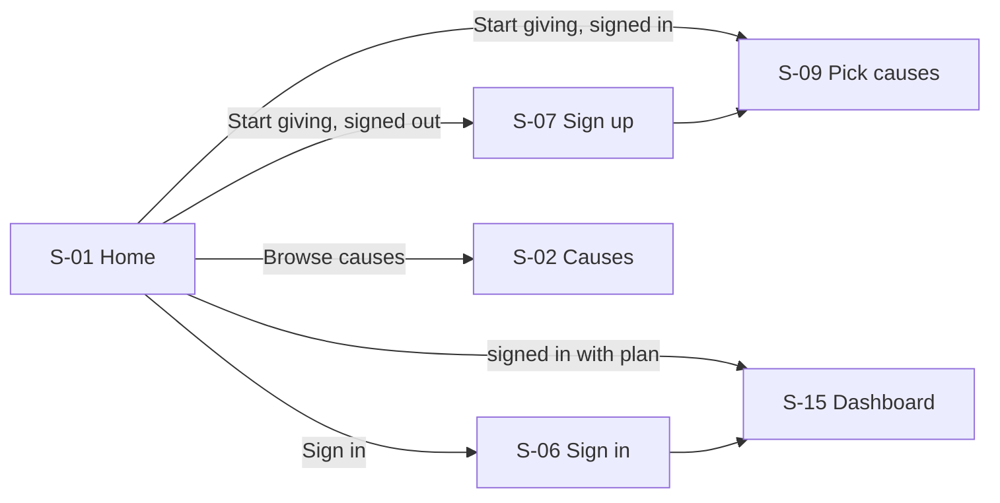

#### F-02 · Browse causes → cause detail → add to plan
- **Goal:** "Show me the causes and let me see what a cause actually does before I pick it."
- **Entry:** S-01 cause cards, nav *Causes*, footer.
- **Steps:** S-02 → S-03 → *Add to plan* → S-02b (draft tray) → S-09.
- **Success:** the chosen causes arrive pre-selected in onboarding (draft held in client state, *proposed*).
- **Branches:** filter with no match → S-02a. Unknown or inactive slug → S-03a. Cause already added, or 5 already chosen → S-03b. Cause has no metrics or no nonprofits → S-03c. Signed out when adding → draft kept, S-07 first (*proposed*).
- **[OPEN]** Where does the "add to plan" draft live before an account exists?

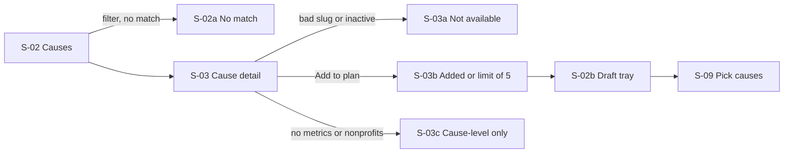

#### F-03 · How it works
- **Goal:** "Tell me in a minute how this works and what happens to my money."
- **Entry:** nav, footer, S-01, S-11 and S-14 help links.
- **Steps:** S-04 → *Start giving* → F-01 path.
- **Success:** donor understands recurring plan, AI-assisted split, manual editing, mocked payment, impact method.
- **Branches:** none beyond a "see the trust page" link to S-05.

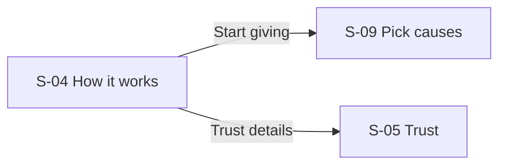

#### F-04 · Trust page
- **Goal:** "Before I give, show me how fees, verification, AI and impact numbers work, and that I can stop any time."
- **Entry:** footer, S-01 trust strip, fee notes on S-11 and S-14, verification marks on S-03, methodology link on S-21.
- **Steps:** S-05 → back to the screen that sent the donor there (history back).
- **Success:** donor can find fee assumptions, verification statuses, impact methodology, AI constraints, edit/pause/cancel promise.
- **Branches:** arriving from a decision screen mid-flow → draft plan must survive (no state loss).

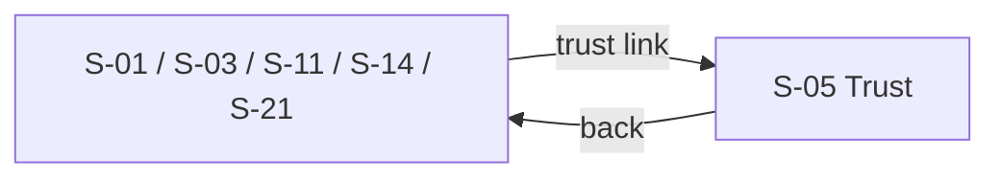

### Account

#### F-05 · Sign up → onboarding
- **Goal:** "Make me an account quickly and take me straight to picking causes."
- **Entry:** S-01, S-06 link, F-07 redirect.
- **Steps:** S-07 → S-09.
- **Success:** mock account exists and onboarding starts.
- **Branches:** invalid email, empty or weak password, email already used → S-07a. Mock auth (no real backend yet): sign-up creates the demo session, *proposed*. Skip account and onboard anonymously → **[OPEN]** (D-06).

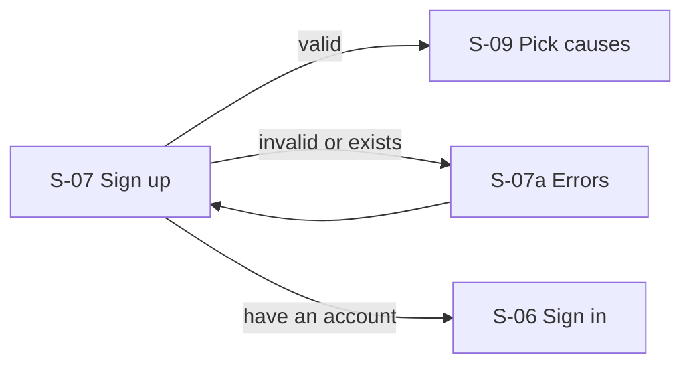

#### F-06 · Sign in → dashboard
- **Goal:** "Let me back in and show me my plan."
- **Entry:** nav *Sign in*, S-07 link, F-07 redirect.
- **Steps:** S-06 → S-15 (by plan status: S-15, S-15b, S-15c).
- **Success:** donor lands on the dashboard in the state that matches their plan.
- **Branches:** wrong credentials → S-06a. Account but onboarding unfinished → S-15d. Paused plan → S-15b. Cancelled plan → S-15c. Forgot password → S-08.

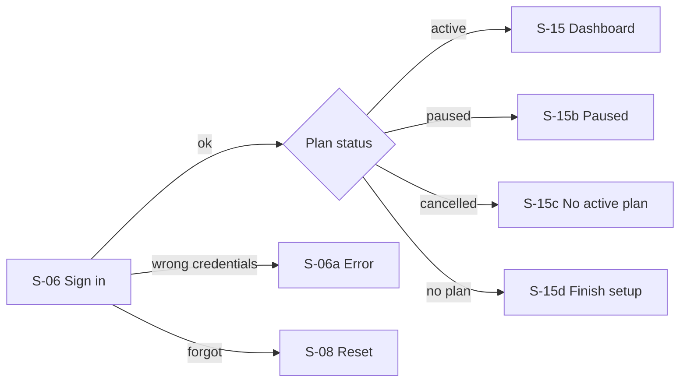

#### F-07 · Signed-out user hits a donor route
- **Goal:** "I clicked a link to my plan; get me signed in and put me back where I was."
- **Entry:** any of `/dashboard`, `/plan/*`, `/checkout`, `/impact*`, `/donations`, `/settings`, `/onboarding` while signed out.
- **Steps:** requested route → S-06b → S-06 → original route.
- **Success:** donor ends on the route they asked for.
- **Branches:** donor has no account → S-07 link on S-06b. Return path is unsafe or unknown → fall back to S-15. Nothing guards routes in code today (D-07).

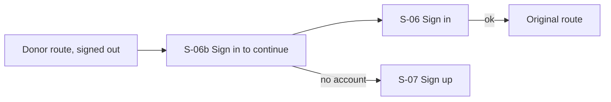

#### F-08 · Forgot password *(proposed)*
- **Goal:** "I can't remember my password."
- **Entry:** S-06, S-06a.
- **Steps:** S-06 → S-08 → confirmation → S-06.
- **Success:** donor can sign in again. **Gap:** no docs, Figma or code covers it. **[OPEN]** whether mock auth needs it at all.

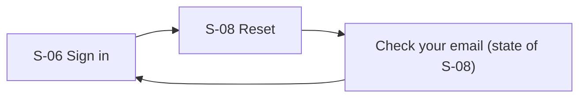

#### F-09 · Delete account *(proposed)*
- **Goal:** "I want my data gone."
- **Entry:** S-23.
- **Steps:** S-23 → S-24 → S-01.
- **Success:** account and donor profile removed. **Gap:** no source mentions deletion. Must not be a dark pattern; cancelling a plan (F-16) is a separate, easier path. **[OPEN]**

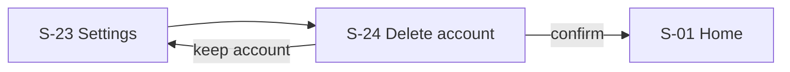

### Activation

#### F-10 · Onboarding: causes, priority style, monthly amount
- **Goal:** "Tell it what I care about and what I can afford, with a few taps."
- **Entry:** F-01, F-02, F-05, S-15d.
- **Steps:** S-09 → S-10 → S-11 → S-12.
- **Success:** a draft of 1–5 causes, a priority style (default `balanced`) and a monthly amount in cents, with no long-form text.
- **Branches:**
  - no cause chosen → S-09a, Continue disabled
  - more than 5 → S-09b, extra cause not added
  - priority style skipped → `balanced` (optional per product context)
  - custom amount empty, zero, negative, not a number → S-11a
  - below minimum → S-11b (**[OPEN]**: no minimum is defined anywhere)
  - donor leaves mid-way → draft kept, S-15d on return
- Presets: `DEFAULT_MONTHLY_AMOUNTS_CENTS` = 300, 500, 1000, 2000 plus Custom. Recommended default $5.

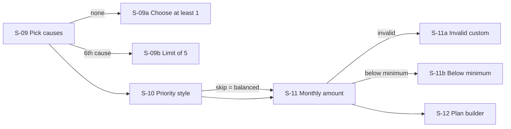

#### F-11 · Plan builder → AI review
- **Goal:** "Show me a sensible split I can understand and change."
- **Entry:** S-11, F-14.
- **Steps:** S-12 → S-13a (generating) → S-13 → *Accept* → S-14.
- **Success:** the allocation totals 100% and the donor has accepted or edited it (`AiRecommendation.acceptedAt`).
- **Branches:**
  - no draft (direct visit) → S-12a, send back to S-09
  - donor edits and total ≠ 100% → S-13b, Continue disabled, shows what is left
  - donor picks `urgent`, `long_term` or `local_or_community` → S-13c
  - donor picks even split → S-13d
  - AI output malformed or AI unavailable → S-13e, deterministic fallback, "simplified" caveat
  - AI names an unknown or inactive cause → S-13f, entry dropped, fallback, warning
  - cause has no metrics or nonprofits → S-13g, cause-level only, no estimate shown
- AI never decides causes or amounts on its own: only the donor's selected causes are allocated.

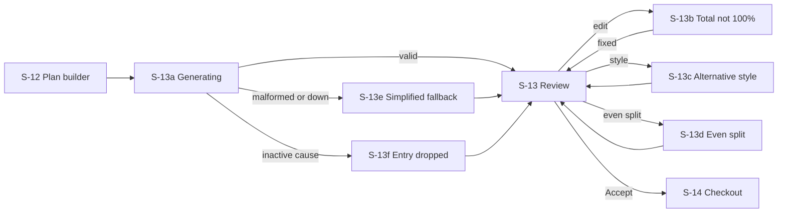

#### F-12 · Checkout
- **Goal:** "Show me exactly what I'm agreeing to, when money moves, and let me confirm."
- **Entry:** S-13 *Accept*, F-14 confirm.
- **Steps:** S-14 → S-14b (processing) → S-14c → S-15a.
- **Success:** a mocked plan becomes `active`, `nextChargeDate` set, first mocked `Donation` created.
- **Shows before confirming:** monthly amount, split, fee, net donation (`netAmountCents`), cadence, next charge date, and when money moves (today / first payment / reminder before each charge, *proposed*).
- **Branches:**
  - no valid plan → S-14a, back to S-12
  - mock payment fails → S-14d, retry or edit plan, no plan created
  - mock payment pending → S-14e, plan not yet active (**[OPEN]**: `DonationPlanStatus` has no pending state)
  - donor cancels or backs out → S-14f, draft kept
  - signed out → F-07
- Never collects real card data.

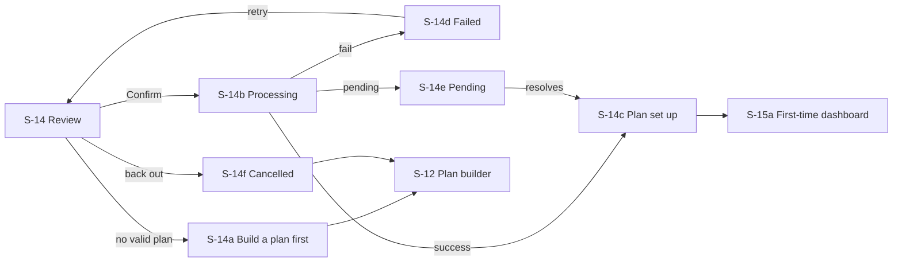

#### F-13 · After activation: first-time dashboard
- **Goal:** "Confirm it worked and tell me what happens next."
- **Entry:** S-14c.
- **Steps:** S-14c (tracker: plan set up → first payment → sent to nonprofits → first impact report) → S-15a.
- **Success:** donor sees active plan, next charge date, allocation, and a clear "first report comes later" line.
- **Branches:** no impact report yet → S-20a; first charge still pending → tracker shows it, S-15a; donor goes to S-20 early → S-20a.

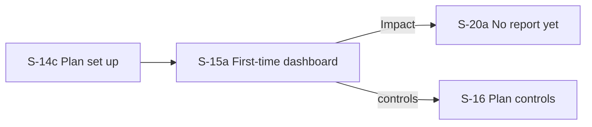

### Retention and plan control

#### F-14 · Edit plan: amount, causes, split
- **Goal:** "Change what I give or where it goes without starting over."
- **Entry:** S-15 / S-23 *Edit*.
- **Steps:** S-16 → S-16a (amount, reuses S-11) · S-16b (causes, reuses S-09) · S-16c (split, reuses S-13) → S-16d → S-15.
- **Success:** change saved, effective from the next charge date (*proposed*); nothing already charged changes.
- **Branches:** editing causes forces a new split (S-16c); total ≠ 100% → S-13b; plan paused or cancelled → edit offered only for paused (*proposed*); cancelled → S-15c. No route exists for edit in IA (D-09).

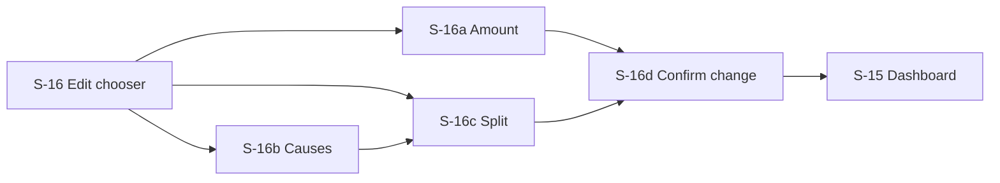

#### F-15 · Pause and resume
- **Goal:** "Stop it for a while, then turn it back on."
- **Entry:** S-15, S-23.
- **Steps:** S-17 → S-15b → S-18 → S-15.
- **Success:** `status` `paused` with `pausedAt`; resume restores `active` and sets a new next charge date.
- **Branches:** pause when already paused or cancelled → S-17a (no-op, explains state); resume when not paused → control not shown, S-17a wording; paused plan still shows reminders off (F-19).

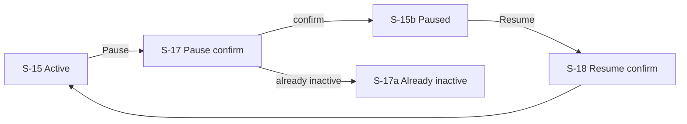

#### F-16 · Cancel
- **Goal:** "End my plan, no hassle, no guilt."
- **Entry:** S-15, S-15b, S-23.
- **Steps:** S-19 → S-15c.
- **Success:** `status` `cancelled` with `canceledAt`; history and reports stay visible.
- **Branches:** cancel when already cancelled → S-19a; plan paused → cancel allowed. Copy must not pressure (AI doc and ethics rules). Offering "pause instead" is fine only as a plain link, not a blocker.

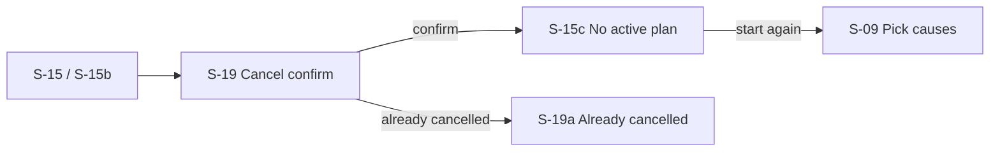

#### F-17 · Donation history
- **Goal:** "See what I've given and what each charge was."
- **Entry:** nav *Donations*.
- **Steps:** S-22.
- **Success:** a row per charge: date, amount, fee, net, status, plan.
- **Branches:** no donations yet → S-22a. Statuses `mocked`, `pending`, `failed`, `cancelled` each render distinctly.

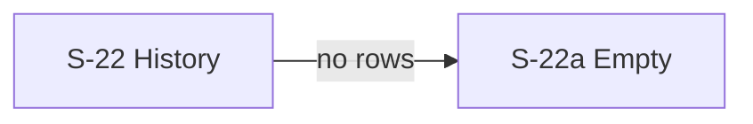

#### F-18 · Settings
- **Goal:** "Change my details, notifications and plan controls in one place."
- **Entry:** nav *Settings*.
- **Steps:** S-23 (profile, notifications, payment placeholder, plan controls S-23a) → S-16 / S-17 / S-19 / S-24.
- **Success:** preferences saved (mock).
- **Branches:** no plan → plan section shows "no plan" with a start link; payment method is a placeholder and collects nothing.

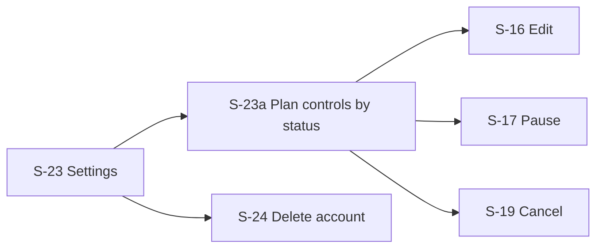

#### F-19 · Reminder before each monthly charge *(proposed, from the pillowtalk reference)*
- **Goal:** "Tell me before money moves so it never surprises me."
- **Entry:** system trigger a set number of days before `nextChargeDate` (**[OPEN]**: how many).
- **Steps:** S-29 (email, plus in-app banner on S-15) → S-15 or S-16.
- **Success:** donor sees the amount and date, with edit / pause one tap away.
- **Branches:** reminder switched off in S-23 → none sent; plan paused or cancelled → none sent. `User.notificationPreferences` has no reminder key today (D-14).

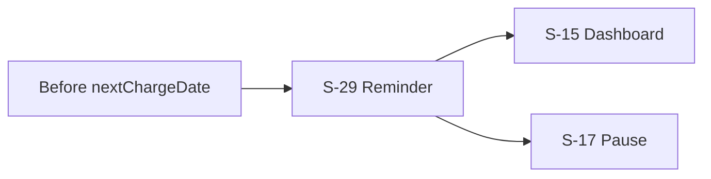

### Impact

#### F-20 · Impact list
- **Goal:** "See what my giving has supported so far."
- **Entry:** nav *Impact*, S-15 latest-report preview, S-29 report-ready notice.
- **Steps:** S-20 → S-21.
- **Success:** latest report and past periods listed, each with a demo label where `isDemo`.
- **Branches:** no report yet → S-20a (says when the first is expected, **[OPEN]** no schedule defined).

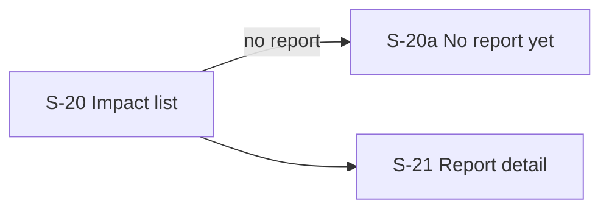

#### F-21 · Report detail and optional share card
- **Goal:** "Understand what the estimates mean and how they were worked out."
- **Entry:** S-20, S-15, S-29 report-ready notice.
- **Steps:** S-21 → (optional) S-21c.
- **Success:** donor sees period, total, per-cause amounts, estimated units, methodology and caveats.
- **Branches:**
  - unknown `reportId` → S-21a (404)
  - a metric lacks a source or caveat → S-21b, estimate not shown (acceptance rule)
  - share card → S-21c, amounts hidden by default; no social integration in MVP

```mermaid
flowchart LR
  S21["S-21 Report"] -->|bad id| S21a["S-21a Not found"]
  S21 -->|metric w/o source| S21b["S-21b Estimate withheld"]
  S21 -->|Share| S21c["S-21c Share card, amounts hidden"]
```

### Cross-cutting

#### F-22 · Demo and not-verified labelling
- **Goal (donor):** "Don't let me think a demo is real."
- **Entry:** every screen; global banner S-27 plus per-record labels.
- **Rule:** seed records (`isDemo`, `isPlaceholder`, `verificationStatus` other than `verified`) are labelled demo or "not verified"; no screen may say a nonprofit is verified or partnered unless the record says so.
- **Branches:** `/demo` (S-28) carries the banner at all times.

```mermaid
flowchart LR
  D["Seed record"] -->|isDemo or isPlaceholder| L["Label on the screen (S-27)"]
  D -->|verified| V["Verification mark"]
```

#### F-23 · Not found, error and loading
- **Entry:** unknown URL, thrown error, slow data.
- **Steps:** S-25 / S-26, with a way back to S-01 or S-15.
- **Branches:** `notFound()` already used for unknown cause and report (D-10); no `loading.tsx` or `error.tsx` exists.

```mermaid
flowchart LR
  X["Bad URL or thrown error"] --> S25["S-25 Not found"]
  X --> S26["S-26 Error"]
  S25 --> S01["S-01 Home"]
  S26 --> S01
```

### Later (roadmap phases 2–6, one line each, not designed here)

- **Phase 2 · Better giving intelligence:** richer cause quiz, more strategies, optional one-time gifts, more nonprofits, tax-receipt placeholders.
- **Phase 3 · Trust and reporting depth:** methodology depth, source management, report history and comparisons, verification workflows, fund-routing disclosure.
- **Phase 4 · Social and growth:** optional share cards beyond the MVP one, referrals, group giving experiments, privacy controls.
- **Phase 5 · Charity tooling:** profile claiming, charity dashboard, verified impact updates (the Figma "SaaS Tool" belongs here, not in the MVP).
- **Phase 6 · Platform expansion:** corporate giving and matching, internationalisation and multi-currency, native apps, volunteering.

---

## B. Screen inventory

### B.0 Layouts and desktop differences

| Layout | Used by | Today in code | Mobile 390 | Desktop 1440 |
|---|---|---|---|---|
| Public | S-01–S-05, S-25, S-31 | `components/layout/PublicLayout.tsx` | Nav collapses to logo + *Start giving* (the link row is `hidden md:flex`) | Full nav row, 6xl content width, footer row |
| Auth | S-06–S-08 | **no `AuthLayout`**; pages use `PublicLayout` | Single column form | Centred narrow column (`max-w-xl` today) |
| Decision | S-09–S-14 | `DecisionLayout.tsx` | One decision per screen, primary action pinned bottom (design direction) | `lg` two columns: content + 320 px side note (today an "MVP note" box) |
| DonorApp | S-15–S-19, S-22–S-24 | `DonorAppLayout.tsx` + `DonorNav.tsx` | Nav is a horizontal scroll strip above content **[OPEN]** (legacy bottom bar is "leave") | 64-unit (256 px) left sidebar |
| Report | S-20, S-21 | `ReportLayout.tsx` (wraps DonorApp) | Single column | Same shell, `max-w-5xl` |

Screen-specific desktop notes: **S-02** 1 → 2 columns of cause cards (today `md:grid-cols-2`); **S-03** side column (nonprofits, uncertainty) drops under the content on mobile; **S-13** split option D is a vertical flow on mobile and may sit beside the totals on desktop; **S-14** the "when money moves" block moves into the 320 px side column on desktop; **S-15** controls move from stacked rows to a column beside the allocation; **S-21c** share card is a fixed 390 px card on both.

### B.1 Public

| ID | Route | Layout | Purpose | Data shown | Primary action | Secondary actions | Trust surfaces | States | In code today | Legacy Figma | Reference pattern | Open questions |
|---|---|---|---|---|---|---|---|---|---|---|---|---|
| S-01 | `/` | Public | Say what Altrue is and start giving | `causes`: `name`, `shortDescription`, `slug` (3–5 examples) | Start giving → S-09 or S-07 | Browse causes → S-02 · Sign in | Trust strip: editable split, cancel anytime, fee clarity, verified-or-reviewed data (TS-1) | Signed-out default | `app/page.tsx`, scaffold; slices **all 8** causes, hero says "scaffold", dashed `PlaceholderCard` | `61-1066`, `122-1746`, `122-1723`: **keep** mission block; **leave** "Urgent need" cards, stock photos, gradient, bottom bar | `ref-betterment.png`: "based on what you tell us, we'll recommend" framing | "Verified or reviewed" claim vs all-placeholder data (D-14) |
| S-01a | `/` | ↑ | Same page for a signed-in donor | ↑ + `DonationPlan.status` | Continue (→ S-09 if unfinished) or Dashboard → S-15 | ↑ | ↑ | Signed in *(proposed)* | not built | `852-376` Logged-in landing: **leave** (crisis-led) | — | Needed at all, or redirect to S-15? |
| S-02 | `/causes` | Public | Browse the MVP causes, cause-first | `causes`: `name`, `shortDescription`, `tags`, `exampleImpactMetrics`, `isActive`, `sortOrder` | Open a cause → S-03 | Filter by tag · Add to plan | Demo label on any metric shown (TS-2) | Default list | `app/causes/page.tsx`, scaffold: 8 cards, shows 3 tags, **no filter, no add-to-plan** | `72-1368`, `72-2495`: **keep** one card per cause with description; **leave** "supporters" counts (no data) and Subscribe | `ref-sumeria.png`: label/value rows instead of floating cards | Filter vs tags: which? "Verified charities" count has no backing field |
| S-02a | `/causes` | ↑ | Filter returns nothing | ↑ | Clear filters | ↑ | ↑ | No match | not built | — | — | — |
| S-02b | `/causes` | ↑ | Show what the donor has picked so far | draft `selectedCauseIds` (1–5) | Continue → S-09 | Remove a cause | ↑ | Draft tray *(proposed)* | not built | — | `ref-betterment.png`: named goals with a check once set | Draft storage before account (D-06) |
| S-03 | `/causes/[slug]` | Public | Explain one cause and its evidence limits | `Cause`: `userFacingExplanation`, `exampleInterventions`, `uncertaintyNotes`; `ImpactMetric`: `name`, `unit`, `costPerUnitCents`, `source`, `caveat`, `isDemo`; `Nonprofit`: `name`, `verificationStatus`, `trustNotes`, `isPlaceholder` | Add to plan | Back to list | Verification status + source notes + uncertainty notes (TS-2) | Default | `app/causes/[slug]/page.tsx`, scaffold: all parts shown, **no add-to-plan**, status printed as raw `verificationStatus` | `72-1641` Campaign page: **keep** verified-org line and cost breakdown idea; **leave** goal-vs-raised, supporters, Share | `ref-google-pay.png`: verified mark next to the recipient | Source field: none on `Cause` (D-04). Show cost per unit at all? |
| S-03a | `/causes/[slug]` | ↑ | Unknown or inactive slug | — | Back to causes | ↑ | — | Not available | `notFound()` for unknown slug only; `getCauseBySlug` does **not** check `isActive` | — | — | Inactive cause: 404 or "not available now"? |
| S-03b | `/causes/[slug]` | ↑ | Add-to-plan feedback | draft count | Continue → S-02b/S-09 | Remove | ↑ | Added · limit of 5 reached | not built | — | — | — |
| S-03c | `/causes/[slug]` | ↑ | Cause with missing data | `Cause` only | Add to plan | ↑ | "Estimate not available yet" rather than a gap | No metrics or no nonprofits | not built (seed always has both) | — | — | Wording owned by copy flow |
| S-04 | `/how-it-works` | Public | Explain recurring plan, AI split, editing, mocked payment, impact method | static copy; 5 steps in code | Start giving → S-09 | Trust → S-05 | Fee and payment assumptions stated | Default | `app/how-it-works/page.tsx`, scaffold: 5 titled cards with filler text | none (slide `122-2016` is case-study prose, not UI) | `ref-betterment.png` "How it works" pages: short numbered steps | — |
| S-05 | `/trust` | Public | One place for fees, verification, impact method, AI limits, user control | `VerificationStatus` (3 values), `MOCKED_FEE_CENTS`, AI rules (`docs/AI_DONATION_ASSISTANT.md`) | Back / Start giving | Cause taxonomy link | Whole screen is the trust surface | Default | `app/trust/page.tsx`, scaffold: 4 cards (Payments, AI, Nonprofits, Impact) | none (IA `61-1214` lists "Financial transparency" under a charity page) | `ref-sumeria.png`: plain label/value rows | How Altrue is funded and any fee are undefined (D-10) |

### B.2 Auth

| ID | Route | Layout | Purpose | Data shown | Primary action | Secondary actions | Trust surfaces | States | In code today | Legacy Figma | Reference pattern | Open questions |
|---|---|---|---|---|---|---|---|---|---|---|---|---|
| S-06 | `/auth/sign-in` | Auth | Return to the dashboard | `User.email` (no password field exists on `User`) | Sign in → S-15 | Create account → S-07 · Forgot → S-08 | — | Default | `app/auth/sign-in/page.tsx`, scaffold: placeholder card, no form | none | — | Mock auth shape: demo-user session? |
| S-06a | ↑ | ↑ | Credentials rejected | ↑ | Try again | ↑ | — | Error | not built | — | `ref-sumeria.png`: warm tinted notice | Error wording |
| S-06b | ↑ | ↑ | Explain why sign-in is needed | requested route | Sign in | Create account | — | Redirected from a donor route | not built | — | ↑ | Return-path rule (F-07) |
| S-07 | `/auth/sign-up` | Auth | Create an account, go to onboarding | email, password (form only; not in `User`) | Create account → S-09 | Sign in → S-06 | — | Default | `app/auth/sign-up/page.tsx`, scaffold: placeholder card | `72-1257` Welcome: **keep** email + password, skip; **leave** gradient logo and tier teaser | — | Skip account step? (D-06) |
| S-07a | ↑ | ↑ | Form errors | ↑ | Fix and retry | ↑ | — | Invalid email · weak password · email exists | not built | — | ↑ | Password rules undefined |
| S-08 | `/auth/reset` *(proposed)* | Auth | Recover access | email | Send link | Back to sign in | — | Default · "check your email" | not built | none | — | Needed with mock auth? **[OPEN]** (D-05) |

### B.3 Onboarding and plan

| ID | Route | Layout | Purpose | Data shown | Primary action | Secondary actions | Trust surfaces | States | In code today | Legacy Figma | Reference pattern | Open questions |
|---|---|---|---|---|---|---|---|---|---|---|---|---|
| S-09 | `/onboarding` step 1 | Decision | Choose 1–5 causes | `causes` where `isActive`; `MVP_CAUSE_LIMIT` {1,5}; `DonorProfile.selectedCauseIds` | Continue → S-10 | Skip | — | Default (draft pre-filled from S-02b) | `app/onboarding/page.tsx`, scaffold: static list, **not selectable, no state** | `72-1280`, `837-856`: **keep** grid of causes + Skip; **leave** multicolour Noun Project icons and "amazing verified nonprofits" line | design-direction screen 1 "Pick causes" | Steps in one route or sub-routes (D-09)? |
| S-09a | ↑ | ↑ | Nothing picked | ↑ | Continue disabled | ↑ | — | None selected | not built | — | — | — |
| S-09b | ↑ | ↑ | Sixth cause tapped | ↑ | ↑ | Deselect one | — | Limit of 5 | not built | — | — | — |
| S-10 | `/onboarding` step 2 | Decision | Choose a priority style (optional) | `PriorityStyle`: `balanced` · `urgent` · `long_term` · `local_or_community` | Continue → S-11 | Skip (= `balanced`) | Explain what each style changes | Default | not built | none | `ref-betterment.png`: "based on what you tell us" | `local_or_community` only fits causes tagged `local` or `community` (hunger, mental health) |
| S-11 | `/onboarding` step 3 | Decision | Choose a monthly amount | `DEFAULT_MONTHLY_AMOUNTS_CENTS` 300/500/1000/2000 + Custom; `MOCKED_FEE_CENTS`; `DonorProfile.defaultMonthlyAmountCents` | Continue → S-12 | Custom amount · fee note → S-05 | Fee assumption beside the selector (TS-3) | Default ($5 recommended) | `app/onboarding/page.tsx` shows the four presets + "Custom" as static chips | `845-1924`, `72-1315`: **keep** "pick your own monthly amount"; **leave** €10/€25 tiers, free trial, premium (D-02) | `ref-google-pay.png`: one huge centred amount | Minimum amount **[OPEN]** |
| S-11a | ↑ | ↑ | Custom input invalid | ↑ | Fix amount | ↑ | — | Empty · zero · negative · not a number | not built | — | — | — |
| S-11b | ↑ | ↑ | Custom below the minimum | ↑ | Fix amount | ↑ | Small amounts stay valid, per the AI rules | Below minimum | not built | — | — | No minimum defined (D-08) |
| S-12 | `/plan/new` | Decision | Show the draft before the AI review | `DonorProfile`: `selectedCauseIds`, `priorityStyle`, `defaultMonthlyAmountCents`; equal-split preview | Get a suggested split → S-13 | Edit causes/amount | Fee assumption again | Default | `app/plan/new/page.tsx`, scaffold: prints cause ids and style | none | design-direction has **no** plan-builder screen (D-09) | Merge into S-13? |
| S-12a | ↑ | ↑ | Arrived with no draft | — | Pick causes → S-09 | — | — | No draft | not built | — | — | — |
| S-13 | `/plan/review` | Decision | Review an AI-assisted, editable split | `AiRecommendation.recommendedAllocations`: `causeId`, `percentage`, `amountCents`, `rationale`, `nonprofitIds`, `caveats`; `rationale`; `caveats`; `modelName` "mock-deterministic" | Accept → S-14 | Edit · alternative styles · even split | Rationale per cause, caveats, AI-assisted label, "starting point, adjust before confirming" (TS-4) | Ready | `app/plan/review/page.tsx`, scaffold: static `demoAllocations`, shows raw `causeId`, **no edit, no styles, no validation** | `72-2557` "Personalised recommendation": nothing usable (two words) | `ref-wealthfront.png`: money flows down one line into named buckets (option D); `ref-betterment.png` | Split options A–D still pending in design-direction |
| S-13a | ↑ | ↑ | Waiting for the suggestion | — | — | Cancel | AI-assisted label | Generating | not built | — | — | Needed if mocked and instant? |
| S-13b | ↑ | ↑ | Edited total is not 100% | live `percentage` sum | Fix; Continue disabled | Reset to suggestion | Shows remainder | Total ≠ 100% | not built | — | — | Rounding rule for 3-way splits (D-11) |
| S-13c | ↑ | ↑ | Another priority style | `strategy` | Accept | Back to first | Explain the change | Style changed | not built | — | — | — |
| S-13d | ↑ | ↑ | Equal split | equal `percentage` | Accept | Edit | ↑ | Even split | not built | — | — | — |
| S-13e | ↑ | ↑ | Malformed AI output or AI down | deterministic allocation | Accept | Edit | Caveat: "recommendation was simplified" | Fallback | not built | — | `ref-sumeria.png`: warm notice | — |
| S-13f | ↑ | ↑ | AI names an unknown or inactive cause | allocation without that cause | Accept | Edit | Warning in `warnings` | Entry dropped | not built | — | ↑ | — |
| S-13g | ↑ | ↑ | A cause has no metrics or nonprofits | cause-level allocation | Accept | Edit | "No estimate for this cause" | Cause-level only | not built | — | — | — |

### B.4 Checkout

| ID | Route | Layout | Purpose | Data shown | Primary action | Secondary actions | Trust surfaces | States | In code today | Legacy Figma | Reference pattern | Open questions |
|---|---|---|---|---|---|---|---|---|---|---|---|---|
| S-14 | `/checkout` | Decision | Confirm a mocked plan | `DonationPlan`: `monthlyAmountCents`, `cadence`, `nextChargeDate`, `currency`; `Donation`: `feeCents`, `netAmountCents`; allocation rows | Confirm plan | Edit plan → S-13 · trust link | Amount, cadence, fee, net, split, when money moves (TS-5) | Ready | `app/checkout/page.tsx`, scaffold: amount + fee only, uses `demoPlans[0]` | `72-2551`, `29-587` "Donation / Payment screen": a charity-page outline (mission, transparency, report), **no payment design** | `ref-pillowtalk.png`: today / reminder / charge; `ref-google-pay.png`: paying-from row above the pay button, verified mark | Fee model (D-10); "paying from" row for a mock? |
| S-14a | ↑ | ↑ | No valid plan | — | Build a plan → S-12 | — | — | No plan | not built | — | — | — |
| S-14b | ↑ | ↑ | Confirming | — | — | — | Mock payment label | Processing | not built | — | — | — |
| S-14c | ↑ | ↑ | Plan created (mock) | `nextChargeDate`, plan id | Go to dashboard → S-15a | View plan | Mock label; nothing real charged | Success | not built | — | design-direction screen 5 tracker: plan set up → first payment → sent to nonprofits → first impact report | Tracker is **proposed** |
| S-14d | ↑ | ↑ | Mock payment failed | `DonationStatus` "failed" | Try again | Edit plan | No plan created | Failed | not built | — | `ref-sumeria.png` notice | — |
| S-14e | ↑ | ↑ | Mock payment pending | "pending" | Wait / go to dashboard | — | — | Pending | not built | — | — | Plan status for pending (D-08) |
| S-14f | ↑ | ↑ | Donor backed out | draft intact | Back to review | — | — | Cancelled | not built | — | — | — |

### B.5 Donor app

| ID | Route | Layout | Purpose | Data shown | Primary action | Secondary actions | Trust surfaces | States | In code today | Legacy Figma | Reference pattern | Open questions |
|---|---|---|---|---|---|---|---|---|---|---|---|---|
| S-15 | `/dashboard` | DonorApp | Donor home: plan, next charge, allocation, lifetime total, latest report | `DonationPlan`: `status`, `monthlyAmountCents`, `nextChargeDate`; `DonationAllocation` rows; sum of `Donation.netAmountCents`; latest `ImpactReport` | Edit plan → S-16 | Pause → S-17 · Cancel → S-19 · Impact → S-20 | Plan controls visible (TS-6) | Active | `app/dashboard/page.tsx`, scaffold: status, amount, next date, raw `causeId` list, **controls are text only, no lifetime total** | `72-2396`, `72-2831`: **keep** donation history, "increase donation amount", subscriptions; **leave** impact badges, "progress to monthly goal" | `ref-betterment.png`: recurring row with toggle; `ref-sumeria.png`: envelopes = one pot per cause | Show a "progress" element at all? (D-03) |
| S-15a | ↑ | ↑ | Just activated | tracker + `nextChargeDate` | Impact → S-20a | Controls | ↑ | First time | not built | — | — | — |
| S-15b | ↑ | ↑ | Plan paused | `pausedAt` | Resume → S-18 | Cancel · Edit | ↑ | Paused | not built | — | — | — |
| S-15c | ↑ | ↑ | No active plan | `canceledAt` | Start a plan → S-09 | History · reports | ↑ | Cancelled | not built | — | — | — |
| S-15d | ↑ | ↑ | Account but no plan | — | Continue setup → S-09 | — | — | Onboarding unfinished | not built | — | — | — |
| S-15e | ↑ | ↑ | Latest charge failed *(proposed)* | `Donation.status` "failed" | Fix payment | Pause | Warm notice | Failed charge | not built | — | `ref-sumeria.png` | Out of the MVP's mocked scope? |
| S-16 | sheet over S-15 / S-23 | DonorApp | Choose what to change | plan summary | Amount · Causes · Split | Close | Effect date shown | Open | not built; no route in IA (D-09) | none | — | Sheet or routes? |
| S-16a | `?mode=edit` *(proposed)* | Decision | Change amount (reuses S-11) | `monthlyAmountCents` | Next | Cancel | ↑ | Edit amount | not built | — | — | — |
| S-16b | ↑ | ↑ | Change causes (reuses S-09) | `selectedCauseIds` | Next → S-16c | ↑ | ↑ | Edit causes | not built | — | — | — |
| S-16c | ↑ | ↑ | Change split (reuses S-13) | allocations | Next → S-16d | ↑ | ↑ | Edit split | not built | — | — | — |
| S-16d | ↑ | ↑ | Show what changes and when | before/after, effective date | Save changes | Back | ↑ | Confirm | not built | — | `ref-pillowtalk.png` | Effective date rule |
| S-17 | sheet | DonorApp | Pause the plan | `nextChargeDate` | Pause | Keep plan | "What happens next" | Open | not built | — | — | — |
| S-17a | ↑ | ↑ | Pause when already inactive | `status` | Close | — | — | Already paused or cancelled | not built | — | — | — |
| S-18 | sheet | DonorApp | Resume the plan | new `nextChargeDate` | Resume | Keep paused | ↑ | Open | not built | — | — | — |
| S-19 | sheet | DonorApp | Cancel the plan | what stays visible | Cancel plan | Keep plan · pause instead (plain link) | Calm wording, no pressure | Open | not built | — | — | — |
| S-19a | ↑ | ↑ | Cancel when already cancelled | `canceledAt` | Close | — | — | Already cancelled | not built | — | — | — |

### B.6 Impact, history and settings

| ID | Route | Layout | Purpose | Data shown | Primary action | Secondary actions | Trust surfaces | States | In code today | Legacy Figma | Reference pattern | Open questions |
|---|---|---|---|---|---|---|---|---|---|---|---|---|
| S-20 | `/impact` | Report | Latest report and past periods | `ImpactReport`: `periodStart`, `periodEnd`, `totalDonatedCents`, `summary`, `isDemo` | Open a report → S-21 | — | Demo label (TS-7) | Latest + list | `app/impact/page.tsx`, scaffold: one demo report, linked card | `72-1608` Impact Reportage: **keep** "reports from your causes" list; **leave** "impact stories" row, ongoing campaigns | `ref-sumeria.png` rows | — |
| S-20a | ↑ | ↑ | No report yet | — | Back to dashboard | — | Says reports come monthly (**[OPEN]** schedule) | No report | not built | — | — | — |
| S-21 | `/impact/[reportId]` | Report | One report with methodology and caveats | `ImpactReportItem`: `causeId`, `metricId`, `amountAllocatedCents`, `estimatedUnits`, `narrative`, `methodologyNote`; `ImpactMetric`: `unit`, `source`, `caveat`, `isDemo` | Read methodology | Share → S-21c · Back | Methodology + caveat on every metric (TS-7) | Default | `app/impact/[reportId]/page.tsx`, scaffold: cards with units, amount, methodology; **metric `caveat` not shown** | `122-1935`, `860-1495` Shareable Impact: **keep** share-without-amount idea; **leave** badges, sample numbers (e.g. "320 school meals") | `ref-sumeria.png` rows | Estimates round "conservatively" (1.6 nets → 1) |
| S-21a | ↑ | ↑ | Unknown `reportId` | — | Back to impact | — | — | Not found | `notFound()` | — | — | — |
| S-21b | ↑ | ↑ | Metric without source or caveat | — | — | — | Estimate withheld | Blocked | not built | — | — | — |
| S-21c | ↑ | ↑ | Preview the share card | cause names, units; **no amounts by default** | Share (mock) | Show amounts toggle · Dismiss | Amounts hidden by default | Share card | not built | `122-1935`: **keep** card + "Share my impact" / "Dismiss" | — | Privacy flag has no field (D-12) |
| S-22 | `/donations` | DonorApp | History table | `Donation`: `chargedAt`, `amountCents`, `feeCents`, `netAmountCents`, `status`, `donationPlanId` | — | Open plan | Fees visible | Default | `app/donations/page.tsx`, scaffold: card per row, **no net, no plan link** | `72-2396`: **keep** "Donation history" | `ref-sumeria.png` rows | — |
| S-22a | ↑ | ↑ | No donations yet | — | Start a plan | — | — | Empty | not built | — | — | — |
| S-23 | `/settings` | DonorApp | Profile, notifications, payment placeholder, plan controls | `User`: `name`, `email`, `notificationPreferences`; plan status | Save | Delete account → S-24 | Pause, cancel, notifications, payment assumptions (TS-8) | Default | `app/settings/page.tsx`, scaffold: four cards, plan controls text only | `72-2831` Profile: **keep** subscriptions | — | Reminder preference key missing (D-14) |
| S-23a | ↑ | ↑ | Plan controls by status | `DonationPlan.status` | per status | ↑ | ↑ | No plan · active · paused · cancelled | not built | — | — | — |
| S-24 | modal *(proposed)* | DonorApp | Delete account | — | Delete | Keep account | Plain wording | Open | not built | none | — | **[OPEN]** (D-05) |

### B.7 Cross-cutting

| ID | Route | Layout | Purpose | Data shown | Primary action | Secondary actions | Trust surfaces | States | In code today | Legacy Figma | Reference pattern | Open questions |
|---|---|---|---|---|---|---|---|---|---|---|---|---|
| S-25 | any | Public | Not found | — | Home → S-01 | — | — | 404 | Next default only | — | — | — |
| S-26 | any | Public | Error | — | Retry | Home | — | Error | none (no `error.tsx`) | — | — | — |
| S-27 | all | all | Demo banner and per-record labels | `isDemo`, `isPlaceholder`, `verificationStatus` | — | Link to S-05 | Demo state never hidden (TS-1…8) | Always on | partly: footer "Demo data only"; banner is T-03 | — | `ref-sumeria.png`: warm tinted notice | Banner wording is T-03 |
| S-28 | `/demo` | Decision | Demo slice: pick ≤3 causes, equal-split $5 | `causes` subset, seed notes | Request equal split | Back · Reset | Banner always visible | per T-05 | not built; T-05 | none | — | Provenance gate (D-04) |
| S-29 | email + in-app *(proposed)* | — | Reminder before a charge, and report-ready notice | `nextChargeDate`, `monthlyAmountCents` | Open dashboard | Pause · edit | Plain, no urgency | Reminder · report ready | not built | none | `ref-pillowtalk.png` | Lead time **[OPEN]** |
| S-31 | `/privacy`, `/terms` *(proposed)* | Public | Footer placeholders | static | — | — | Placeholder label | Default | not built | none | — | Routes not in IA |

---

## C. Evidence

Every item below was opened in this run. Single `views/*.png` files were **not** opened; exact wording came from `views/*.json`.

**Text and code**
`docs/IA_AND_ROUTES.md`, `docs/MVP_REQUIREMENTS.md`, `docs/AI_DONATION_ASSISTANT.md`, `docs/ALTRUE_PRODUCT_CONTEXT.md`, `docs/ROADMAP.md`, `docs/CAUSE_TAXONOMY.md` (headings and first cause only), `.agents/CODEMAP.md`, `.agents/BRIEF.md`, `.agents/PLAN.md` (head), `.agents/tasks/T-05-*.md`, `app/**/page.tsx` (all 16), `components/layout/*.tsx`, `components/PlaceholderCard.tsx`, `lib/seed/*.ts`, `lib/types/index.ts`, `lib/constants.ts`, `lib/formatters.ts`, `.context/inputs/design-direction.md`, `altrue-legacy-audit.md`, `cause-sources-2026-10-29.md`, `impact-data-apis-2026-10-29.md`, `references/references.md`.
`docs/PRODUCT_DIRECTION.md` is empty (0 lines).

**Contact sheets** (all 17, in `.context/inputs/figma-sheets/`): `00-Cover-0`, `01-Project-Overview-Case-Study-0`, `02-To-Do-0`, `04-Survey-Questions-Dicovery-0`, `05-EAGx-Notes-0`, `06-User-Stories-Basic-0` (too small to read; its frame `122-2193` has no text in the JSON either), `07-Information-Architecture-0`, `09-UI-Mockups-App-0`, `09-UI-Mockups-App-1`, `11-UX-Wireframes-Altrue-APP-0`, `-1`, `-2`, `12-UX-Wireframes-SAAS-Tool-0`, `14-Brand-Design-0`, `15-Components-0`, `16-EAGx-Slide-0`, `18-Conclusion-Slide-0`.

**Frame JSON** (in `.context/inputs/figma/views/`): `72-1368`, `72-1641`, `72-1608`, `122-1935`, `72-2831`, `72-2396`, `72-2551`, `72-2557`, `72-1315`, `72-1257`, `72-1280`, `837-856`, `845-1924`, `122-1746`, `72-1582`, `72-2570`, `72-2232`, `61-1214`, `838-1273`, `852-376` (JSON only returned no text), `122-2193` (no text).

**References** (all 5, in `.context/inputs/references/`): `ref-wealthfront.png`, `ref-pillowtalk.png`, `ref-google-pay.png`, `ref-sumeria.png`, `ref-betterment.png`.

**Not opened:** all single `views/*.png`; `assets/*.pdf`; `components/*`, `styles.json`, `tokens.json` in the Figma export; the rest of `CAUSE_TAXONOMY.md`.

**Caveats on the legacy Figma:** the export's only date is `exportedAt` 2026-10-28. The wireframes are a UX sketch set ("not perfect by any means", per the file's own note) and the survey is 30 peers.

---

## D. Conflicts and gaps

Each row has a suggested resolution. Rows marked **[OPEN]** need the human's call; D-24 and D-25 are notes.

| # | Disagreement | Sources | Suggested resolution |
|---|---|---|---|
| D-01 | **Currency.** Code and docs use USD (`Currency = "USD"`, `formatCents` defaults to USD, `$3/$5/$10/$20`); the survey and Figma use euros (€6–10, €10 and €25). Multi-currency is non-MVP. | `lib/types`, `docs/MVP_REQUIREMENTS.md`, audit, Figma `845-1924` | Keep USD for the demo, say so on S-11 and S-14, and note that the survey's euro bands are not directly comparable. **[OPEN]** |
| D-02 | **Tiers.** Figma has €10 basic (up to 3 causes) and €25 premium; "premium tiers" are non-MVP; the survey's top answers were "let me choose" and €6–20. | Figma `845-1924`, `docs/MVP_REQUIREMENTS.md`, audit | Drop tiers. Use presets plus custom, and the 1–5 cause limit. **[OPEN]** |
| D-03 | **Badges, goals and sharing.** Figma has impact badges, "progress towards monthly goal (implicit gamification)", and "share my impact"; docs list complex gamification as non-MVP and sharing as should-have, amounts hidden. | Figma `72-2831`, `72-2396`, `122-1935`; docs | Keep only the share card (S-21c) with amounts hidden. No badges, no goal progress. **[OPEN]** |
| D-04 | **Per-cause sources missing.** `Cause` has no source field; `ImpactMetric.source` is "Demo seed estimate" for all 8; nonprofit `impactSourceNotes` is "Demo source notes only". Research dated 2026-10-29 found WHO, UNESCO, UNEP and CBD sources that support the **topics** of 3 causes but not Altrue's wording, the education examples, or any named charity. | T-01 receipt, CODEMAP, `lib/seed`, `cause-sources-2026-10-29.md` | Add a typed source record (stable id, publisher, edition, URL, date, data period, claim, caveat, review status) in a later card. Until then S-03 shows "demo" and nothing that looks verified. **[OPEN]** |
| D-05 | **No password-reset or account-deletion screens** in docs, Figma or code. | docs, code | Mock auth may not need reset. Add S-08 and S-24 only if the demo includes real accounts. **[OPEN]** |
| D-06 | **Account before or after onboarding.** `IA_AND_ROUTES.md` marks `/onboarding` authenticated; the code's "Start giving" links straight to it; the MVP flow goes landing → onboarding with no sign-up step; Figma puts email + password first; product context warns that early commitment causes drop-off. | IA, `PublicNav.tsx`, MVP flows, Figma `72-1257` | Recommend: onboard and build the plan signed-out, require the account at checkout. Costs a draft-storage decision. **[OPEN]** |
| D-07 | **No route guards.** Nothing in `app/` or middleware blocks donor routes for signed-out visitors. | CODEMAP, code | F-07 needs a guard before any of this is real. **[OPEN]** |
| D-08 | **Statuses.** `DonationPlanStatus` = active/paused/cancelled (no pending); `DonationStatus` = mocked/pending/failed/cancelled (no success value; "mocked" stands in). The edge cases need "mocked, failed, pending or cancelled" at checkout. No minimum donation amount is defined, though "below minimum" is an edge case. | `lib/types`, MVP edge cases | Treat `mocked` as success; add a plan-level pending state if S-14e is kept; define the minimum. **[OPEN]** |
| D-09 | **Routes missing for plan edit, steps, and the canvas.** IA has no route for editing a plan or for onboarding steps. The Claude Design canvas has one "Split" screen; IA has `/plan/new` and `/plan/review`. Split options A–D are pending. | IA, `design-direction.md` | Reuse S-09/S-11/S-13 with `?mode=edit`; fold S-12 into S-13 unless a separate builder earns its keep. **[OPEN]** |
| D-10 | **Fees and funding.** `MOCKED_FEE_CENTS` = 0 while the docs require fee, net donation, and "how Altrue is funded / whether tips exist". No fee model exists. | `lib/constants`, product context | Show the rows with $0 and "demo" until a fee model exists. **[OPEN]** |
| D-11 | **Rounding.** AI doc wants percentages totalling 100 and avoids allocations under 10% for 3+ causes; five causes at $3 = $0.60 each; integer percentages cannot split 3 ways exactly; T-05 splits $5 in cents (1.67/1.67/1.66). | AI doc, T-05 | One rule for both percentages and cents (largest remainder, stable order). **[OPEN]** |
| D-12 | **Share card privacy.** Docs say amounts hidden by default; no field records the donor's choice, and `ImpactReport.isDemo` is the only flag. | docs, `lib/types` | Keep the toggle local to the screen; no new field. **[OPEN]** |
| D-13 | **AI output shape.** The AI doc's JSON has `summary`, `strategy`, `assumptions`, `warnings`, `dataSources`, `requiresUserReview`; the `AiRecommendation` type has `rationale`, `caveats`, `modelName` and none of those. | AI doc, `lib/types` | Align the type with the doc before S-13 is built. **[OPEN]** |
| D-14 | **Reminder.** Proposed (pillowtalk), but `notificationPreferences` only has `monthlyReports` and `productUpdates`. | `lib/types`, `references.md` | Add a reminder preference only if the human accepts F-19. **[OPEN]** |
| D-15 | **Verified claims.** Home trust strip and Figma copy say "verified" nonprofits; all 16 nonprofit records are placeholders with `pending_review` or `data_incomplete`. | docs, `nonprofits.ts`, Figma | No "verified" wording until a record says so. **[OPEN]** |
| D-16 | **Cause coverage.** Seed has 8 causes; Figma shows 15; survey's joint-top cause (human rights and equality, 56.7%) and anti-war (13.3%) are not in the seed; hunger is in the seed but not in the survey. | seed, audit, survey | Keep the 8 for the MVP, record the gap, revisit after real data. **[OPEN]** |
| D-17 | **One plan or many.** Docs say "one monthly recurring donation plan"; seed gives `demo-user` an active and a paused plan. | product context, `demoPlans.ts` | One active plan per donor; drop the second seed plan or relabel it as history. **[OPEN]** |
| D-18 | **Stale demo dates.** Seed `nextChargeDate` 2026-06-01 and the May 2026 report are in the past (today is 2026-10-29). | `lib/seed` | Make dates relative, or label as sample. **[OPEN]** |
| D-19 | **Impact units.** `AGENTS.md` mentions "children educated"; the education metric is "learning hours funded". Figma sample numbers (e.g. "320 school meals", "40 dogs") must never be reused. | `AGENTS.md`, seed, Figma | Use only seed metrics. **[OPEN]** |
| D-20 | **Mobile nav.** Legacy heavy bottom bar is "leave"; the design direction puts the primary action bottom-pinned; code has a scrolling top strip. | audit, direction, `DonorNav.tsx` | Decide in the design system. **[OPEN]** |
| D-21 | **Spelling.** `DonationPlanStatus` uses "cancelled"; the field is `canceledAt`. | `lib/types` | Pick one. **[OPEN]** |
| D-22 | **Footer links.** IA footer lists "Cause taxonomy", "Privacy placeholder", "Terms placeholder" with no routes. | IA | Treat cause taxonomy as `/causes`; add S-31 placeholders. **[OPEN]** |
| D-23 | **Campaigns.** Figma campaign page (goal vs raised, supporters) and ongoing campaigns; the docs have no campaigns in the MVP, and the audit keeps only "cost breakdown" and "verified organisation". | Figma, docs, audit | No campaign screen. **[OPEN]** |
| D-24 | **T-05 scope vs IA.** `/demo` is not in IA; T-05 caps at 1–3 causes at a fixed $5; the MVP allows 1–5 at any amount; T-05's provenance gate is unmet (see D-04). | T-05, CODEMAP | `/demo` stays a labelled sidecar and does not replace S-09–S-13. **[OPEN]** |
| D-25 | **Survey weight.** The survey is 30 peers; feature and amount questions had 13 answers. | audit | Treat as direction, not proof. |

---

## E. Coverage check

### E.1 Routes in `IA_AND_ROUTES.md`

- [x] `/` → S-01
- [x] `/causes` → S-02
- [x] `/causes/[slug]` → S-03
- [x] `/how-it-works` → S-04
- [x] `/trust` → S-05
- [x] `/auth/sign-in` → S-06
- [x] `/auth/sign-up` → S-07
- [x] `/onboarding` → S-09, S-10, S-11
- [x] `/plan/new` → S-12
- [x] `/plan/review` → S-13
- [x] `/checkout` → S-14
- [x] `/dashboard` → S-15
- [x] `/impact` → S-20
- [x] `/impact/[reportId]` → S-21
- [x] `/donations` → S-22
- [x] `/settings` → S-23
- [x] Hidden/non-MVP: `/internal/seed-data`, `/admin/charities`, `/admin/analytics` → deliberately **no screen**; must not appear in navigation

### E.2 Edge cases in `MVP_REQUIREMENTS.md`

- [x] No causes selected → S-09a
- [x] More than 5 causes → S-09b (also S-03b)
- [x] Custom amount below minimum or invalid → S-11a, S-11b
- [x] Allocation total under or over 100% → S-13b
- [x] AI output malformed → S-13e
- [x] AI recommends missing or inactive cause → S-13f
- [x] Checkout without a valid plan → S-14a
- [x] Payment mocked, failed, pending, cancelled → S-14c, S-14d, S-14e, S-14f
- [x] No impact report yet → S-20a, S-15a
- [x] Pause or cancel on an inactive plan → S-17a, S-19a
- [x] Seed data marked demo, not shown as verified → S-27 on every screen, S-03, S-13, S-21

### E.3 Trust Surface Areas in `ALTRUE_PRODUCT_CONTEXT.md`

- [x] Home page trust strip → S-01
- [x] Cause detail verification and source notes → S-03
- [x] Donation amount selector fee assumptions → S-11
- [x] Allocation review rationale and caveats → S-13
- [x] Checkout confirmation with total, fee, net donation, cadence → S-14
- [x] Dashboard plan controls → S-15
- [x] Impact report methodology notes → S-21
- [x] Settings cancellation, pause, notifications, payment assumptions → S-23

### E.4 Acceptance criteria in `MVP_REQUIREMENTS.md`

- [x] Onboarding without long-form text → S-09, S-10, S-11 (taps only; S-07 is the only form)
- [x] Plan from seeded data → S-12, S-13, S-14
- [x] Allocation saved only at 100% → S-13b
- [x] AI never goes outside approved data → S-13e, S-13f, S-13g
- [x] Checkout shows amount, cadence, fee assumptions, net donation → S-14
- [x] Dashboard shows status with edit, pause, cancel → S-15, S-16, S-17, S-19
- [x] Every impact metric has a source note or demo caveat → S-21, S-21b
- [x] No leaderboards, guilt copy or public status mechanics → S-21c (no amounts, no badges); checked against all screens
- [x] No visible route asks charities to manage dashboards → E.1 (admin routes have no screen)

### E.5 Gaps this check surfaced

- Screens that exist only because a source forces them: S-03a, S-14a, S-21a (unknown ids / missing plans).
- Screens that exist only as proposals: S-01a, S-02b, S-08, S-12a, S-13a, S-15e, S-16*, S-24, S-29, S-31. Each is marked *proposed* above.
- Legacy Figma has **no** design for: plan review, checkout, plan controls, history table, settings, trust page, how-it-works, reminder.
